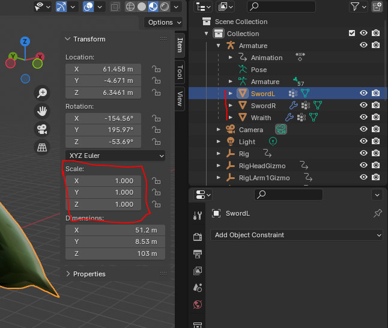
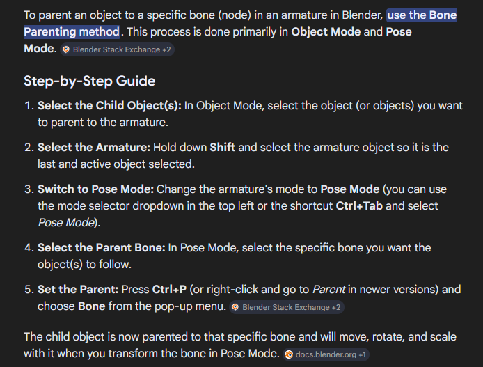

# Porting merged animation fbx with screwed up deformation

This assumes you have an fbx where no timelines are all mergeed together and it has broken/deformed meshes.

You should be able to see the bones all animating correctly.

## Fixing scale

First, select each mesh (red vertical line), press `N` and check the scale (boxed). Make sure the values are consistent.

You should be able to see something less broken.

## Fixing offset meshes

You might find your meshes being offset. To fix this, unparent/unlink your mesh (`Alt-P -> Clear Parent` or `Clear Parent and Keep Transform`), then move (via controls) it to the correct-looking spot, preferably in the A-pose keyframe. Then re-parent the mesh.

**Make sure to scrub the animation timeline to check correctness!**

For attachment meshes, find a specific weapon node to parent to, if it exists. 

After unlinking the attachment (alt-p), they may need to have their origin reset for better control. For this you can try `Right-click -> Set Origin -> Geometry to Origin`, and then edit mode, select all vertices `A` and moving vertices. Then move the object to the node.

Warning: it can be tedious to orient the mesh correctly. Again, scrub the timeline for correctness!

- Alternatively, you can skip the whole going to pose and parenting to bone and instead parent to the armature object instead.
